<h1>Моя учебная программа по программированию</h1>

  <strong>Путь от фундаментальных алгоритмов и создания веб-приложений до проектирования высоконагруженных систем и искусственного интеллекта.</strong>

  
  
  
  
  
  
  
  

  
  
  
  
  
  
  
  

  
  
  
  
  
  
  
  

---

> **О репозитории**
>
> В этом репозитории систематизированы конспекты, практические задания и проекты по ключевым дисциплинам разработки программного обеспечения. Программа выстроена последовательно — от синтаксиса и базовых структур данных до современной бэкенд-архитектуры и машинного обучения.

---

## Разделы программы

  

---

## Технологический стек

<table style="width: 100%; border-collapse: separate; border-spacing: 12px;">
  <tr>
    <td style="width: 25%; padding: 16px; text-align: center; border: 1px solid rgba(128,128,128,0.2); border-radius: 8px; vertical-align: middle;">
      <strong>Язык</strong> 
      Python 3, ООП, asyncio
    </td>
    <td style="width: 25%; padding: 16px; text-align: center; border: 1px solid rgba(128,128,128,0.2); border-radius: 8px; vertical-align: middle;">
      <strong>Фреймворки</strong> 
      FastAPI, Flask, Django, DRF
    </td>
    <td style="width: 25%; padding: 16px; text-align: center; border: 1px solid rgba(128,128,128,0.2); border-radius: 8px; vertical-align: middle;">
      <strong>Базы данных</strong> 
      PostgreSQL, SQLAlchemy, Redis
    </td>
    <td style="width: 25%; padding: 16px; text-align: center; border: 1px solid rgba(128,128,128,0.2); border-radius: 8px; vertical-align: middle;">
      <strong>Инфраструктура</strong> 
      Linux, Docker, CI/CD, Nginx
    </td>
  </tr>
  <tr>
    <td style="padding: 16px; text-align: center; border: 1px solid rgba(128,128,128,0.2); border-radius: 8px; vertical-align: middle;">
      <strong>Тестирование</strong> 
      pytest, Mock
    </td>
    <td style="padding: 16px; text-align: center; border: 1px solid rgba(128,128,128,0.2); border-radius: 8px; vertical-align: middle;">
      <strong>Данные</strong> 
      Pandas, NumPy
    </td>
    <td style="padding: 16px; text-align: center; border: 1px solid rgba(128,128,128,0.2); border-radius: 8px; vertical-align: middle;">
      <strong>ИИ</strong> 
      ML, NLP, нейросети
    </td>
    <td style="padding: 16px; text-align: center; border: 1px solid rgba(128,128,128,0.2); border-radius: 8px; vertical-align: middle;">
      <strong>Боты</strong> 
      Telegram, VK
    </td>
  </tr>
</table>

---

**Навигация по папкам:**

* **[python_developer](python_developer/README.md)** — Основы Python, ООП и боты
* **[python_developer_advenced](python_developer_advenced/README.md)** — FastAPI, Flask, Docker, SQLAlchemy, CI/CD
* **[python_Django](python_Django/README.md)** — Веб-разработка на Django и DRF
* **[python_pandas](python_pandas/README.md)** — Аналитика данных на Pandas
* **[python_ai_cs50](python_ai_cs50/README.md)** — Искусственный интеллект (курс Гарварда)